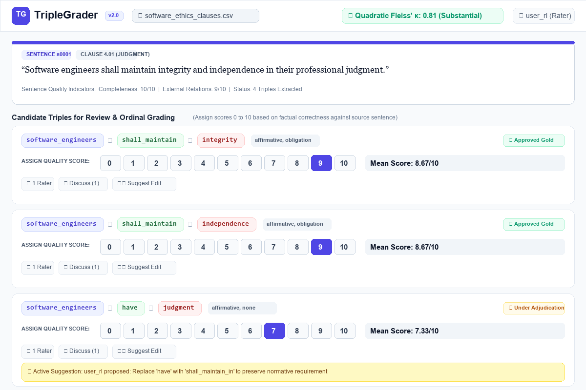

# TripleGrader: Web-Based Collaborative Platform for Triple Grading and Inter-Rater Evaluation

[](https://www.python.org/)
[](https://fastapi.tiangolo.com)
[](https://reactjs.org/)
[](https://www.ieee.org/)
[](LICENSE)

**TripleGrader** is a web-based platform built specifically to evaluate pre-extracted relational (Subject-Predicate-Object) triples and construct certified gold-standard benchmark datasets through multi-annotator review, real-time agreement assessment, and collaborative adjudication.

---

## 🖥️ Interactive Workspace Preview

The interface features the source sentence prominently at the top, with pre-extracted candidate triples, ordinal 0–10 score selectors, and collaborative discussion controls directly below:



*Top: Active source sentence context and sentence-level quality indicators. Below: Extracted relational triple cards with 0–10 ordinal quality grading buttons, rater consensus indicators, and inline revision suggestions.*

---

## 🚀 Key Capabilities

* **Pre-Extracted SPO Triple Evaluation**: Unlike standard span-tagging platforms (e.g., brat, Label Studio, INCEpTION), TripleGrader operates directly on structured relational triples to evaluate factual fidelity, semantic correctness, and sentence-level completeness.
* **0–10 Ordinal Quality Grading**: Raters assign granular quality scores (0 to 10) to capture nuances in extraction quality and partial correctness.
* **Strict Reviewer Isolation**: Grades are isolated by `user_id` so annotators cannot see or overwrite peer evaluations during grading, eliminating anchoring bias.
* **Real-Time Quadratic Inter-Rater Agreement**:
  * **Quadratic Weighted Cohen's Kappa ($\kappa_w$)** for 2 raters.
  * **Quadratic Weighted Fleiss' Kappa ($\kappa_{\text{Fleiss}}$)** for 3 or more raters.
  * Agreement metrics update dynamically as raters submit grades.
* **Threaded Discussions & In-Place Suggestions**: Raters can debate contentious triples, propose replacement tokens, and request removal of spurious extractions.
* **Auditable Gold Benchmark Finalization**: Session owners adjudicate submissions, resolve discussion threads, freeze immutable version releases, and export canonical gold datasets.

---

## 🔄 3-Stage Gold Benchmark Construction Lifecycle


1. **Stage 1: Independent Evaluation**  
   Independent domain graders evaluate candidate triples on a 0–10 ordinal scale without peer anchoring. The platform computes real-time Quadratic Weighted Fleiss' or Cohen's Kappa.
2. **Stage 2: Adjudication and Collaborative Revision**  
   Grades and agreement metrics triage candidates into action tiers:
   * **Unanimous High Consensus** (e.g., `10, 10, 10`): Fast-tracked into the gold benchmark pool.
   * **Minor Discrepancy** (e.g., `9, 9, 10` or `8, 7, 8`): Refined via in-place token suggestions.
   * **High Divergence / Controversy** (e.g., `10, 9, 3`): Triggers active item-level threaded discussions to resolve semantic ambiguity before voting.
   * **Consensus Low Quality** (e.g., `2, 1, 2` or `0, 0, 0`): Flagged for deletion and excluded from the benchmark.
3. **Stage 3: Gold Benchmark Finalization and Version Freezing**  
   Once all discussions and suggestions are resolved (zero unhandled items) and source fidelity is verified, the session owner freezes the dataset into an immutable snapshot (e.g., `v1.0-gold`) and exports the certified gold benchmark.

---

## 🛠️ System Architecture

TripleGrader is structured across three decoupled layers:
* **Frontend**: React single-page application built with Vite, Tailwind CSS, and Framer Motion.
* **Backend**: FastAPI web service in Python implementing RESTful endpoints, JWT bearer authentication, WebSocket broadcasting for real-time discussion sync, and the inter-rater reliability engine.
* **Database & Persistence**: Supabase PostgreSQL accessed via SQLAlchemy ORM with support for relational session payloads, version histories, and user access controls.

---

## ⚡ Quick Start

### Prerequisites
* **Python**: 3.10 or higher
* **Node.js**: 18.0 or higher
* **PowerShell**: (Windows) or bash (Linux/macOS)

### 1. Launch Full Stack (Local Development)

From the repository root, execute:
```powershell
.\start.ps1
```
This automatically starts:
* **Backend**: `http://localhost:8001` (FastAPI + Swagger docs at `/docs`)
* **Frontend**: `http://localhost:5173` (React Vite workspace)

### 2. Manual Startup

**Backend:**
```bash
cd backend
pip install -r requirements.txt
uvicorn main:app --reload --port 8001
```

**Frontend:**
```bash
cd frontend
npm install
npm run dev
```

---

## 📊 Reproducing Paper Empirical Evaluations

To execute the empirical verification test suite (Workflow Correctness EQ1, Controlled Error Recovery EQ2, and Downstream Benchmark Impact EQ3):
```bash
python experiments/run_all_evaluations.py
```

---

## 📄 Citation

If you use TripleGrader or reference this work in your research, please cite:

```bibtex
@inproceedings{lamichhane2027triplegrader,
  author    = {Lamichhane, Rajan and Yue, Songhui},
  title     = {{TripleGrader}: A Web-Based Platform Supporting Collaborative Triple Annotation with Quality Grading and Inter-Rater Agreement Assessment},
  booktitle = {Proceedings of the 21st IEEE International Conference on Semantic Computing (ICSC 2027)},
  year      = {2027}
}
```

---

## 📜 License

This project is licensed under the MIT License — see the [LICENSE](LICENSE) file for details.
